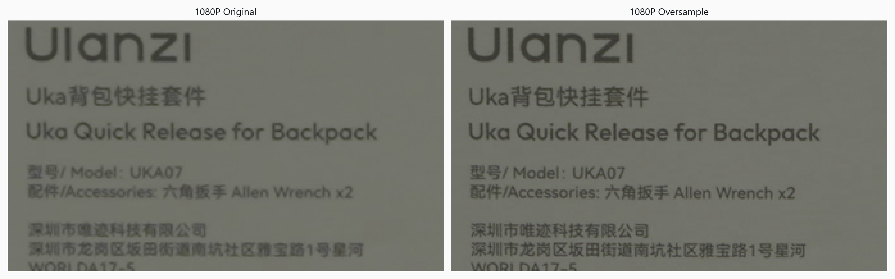
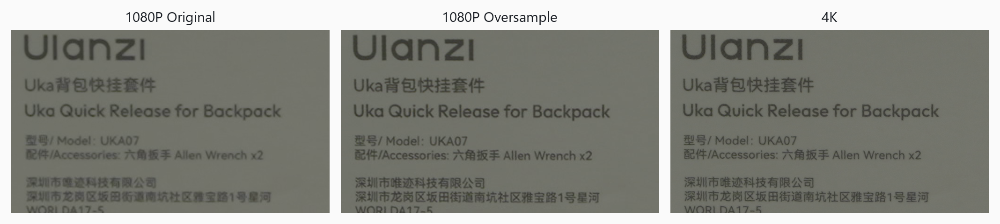
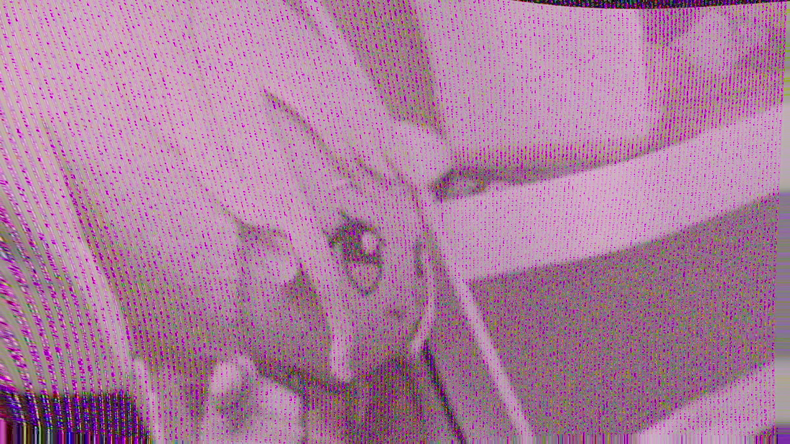

# Sony A6700 1080p 超采样原理与实现

原厂固件在拍摄 1080p 60p 视频时，传感器采用的是跳行抽取（Pixel Skipping）读出，实际只读取 1984×1116 的画面。这种方式功耗低，但会损失大量高频细节。

思路：**让传感器改用 4K 模式下的 6K 全读出（5952×3348），同步更新 ISP（图像信号处理器）的输入参数与畸变计算尺寸，最后再由硬件缩放并编码为 1080p 60p 输出。**





| 环节 | 核心作用 | 关键位置 | 改动量 |
| --- | --- | --- | --- |
| **输入描述符与读出模式** | 将 HD60 的输入描述对齐至 4K60，改为 1:1 直读 | `0xDC7CA0`、`0xEB4E40`、`0xEB52DC` | 21 B |
| **传感器与 ISP 底座** | 切换传感器配置、Bayer 相位及 ISP 描述符槽位 | `0x10CD634`、`0xDC81A8`、`0xDC88EC`、`0x906D80` | 68 B |
| **模式路由（GetImgMode）** | 让 1080p 待机与实时取景进入 4K 对应的处理管线 | `0x00B0D978`、`0x00B0D97C` | 8 B |
| **畸变坐标适配（SPC）** | 修正缩放前畸变补偿的画幅宽高，避免画面撕裂 | `0x009199C8` | 36 B |

---

## 传感器输出 6K 与 ISP

要让画面从“抽取”变成“全读出”，传感器端和 ISP 端必须同步修改，否则两端对画面尺寸和像素排列的理解不一致，会导致偏色、镜像或画面偏移。



### 切换传感器配置与 Bayer 相位

相机的传感器配置存放在 `0x10CD634` 起始的记录表中（步长 `0x14`，有效值在 `+0x04`）。原厂设定中，HD60（模式码 `0x0B20`，索引 10）调用的是 profile 4，而 4K60（模式码 `0x0820`，索引 2）调用的是 profile 1。

* **传感器命令对齐（63 B）**：将表内源列（`+0x01`）的数据复制到值槽（`+0x04`），共 63 处。完成后，HD60 生成的 412 字节传感器控制命令会与 4K60 完全一致。
* **Bayer 相位对齐（4 B）**：全读出与跳行抽取的像素排列相位不同。全读出对应 `(6, 3)`，抽取对应 `(0, 2)`。将索引 2 的这两组枚举值复制到索引 10（分别位于表基 `0xDC81A8` 与 `0xDC88EC` 对应的表项中），即可保证色彩还原正常。

这两处对应的是传感器配置表的整列替换（`0x971310`）：

```c
// HD60 用 idx10，原厂取 profile 4（3×3 抽取）；4K60 用 idx2，取 profile 1（6K 全读出）
// 改写把源列拷进 idx10 的值槽，共 63 处
for (idx = 0; idx < N; idx++)
    record[idx].profile = profile_table[idx][src_col];   // src_col = 1

// HD60 的 412 B 传感器命令流随后与 4K60 一致
// 路径枚举同样取 idx2 的 (6, 3)，共 4 B
record[HD60].path = record[4K60].path;
```

### 切换描述符槽位与输入参数

传感器输出 6K 后，ISP 也需要读取对应的 6K 描述符，才能正确分配后续的滤镜与锐化（PSF）档位。

在 `0x906D80` 处，固件通过立即数决定读取哪个描述符槽位：

```asm
0x906D7C  ldrb.w  r0, [r1, #0x394]     ; 局部选择器
0x906D80  add.w   r3, r1, #0x340       ; 原厂槽 A：HD 描述符（宽 1992）
0x906D8A  it ne
0x906D8C  addne.w r3, r1, #0x37c       ; 槽 B：4K 描述符（宽 5976）
0x906D98  ldrh    r5, [r3, #8]         ; 读取宽度，用于后续 PSF 分档

```

将 `0x906D80` 的 `#0x340` 改为 `#0x37c`（1 B），ISP 就会统一按 5976 宽度解析画面。用 C 写就是 PSF 档位选择固定取槽 B：

```c
// 0x906D72 附近：按描述符宽度选 PSF 表
desc = selector ? obj->slot_b : obj->slot_a;   // 槽 B 即 +0x37C
if      (desc->width > 7168) table = psf_8k;
else if (desc->width > 5120) table = psf_6k;  // 改写后 5976 落这里
else if (desc->width > 3584) table = psf_4k;
else if (desc->width > 2560) table = psf_3k;
else                         table = psf_2k;  // 原厂 HD 的 1992 落这里
```

此外，描述表本身在 HD60（索引 10）这一行仍保留着 1984×1116 的旧参数。需要将两张输入描述符表中索引 2 与索引 10 存在差异的 20 B 同步过来（`0xEB4E40` 起 12 B、`0xEB52DC` 起 8 B），并将 `0x00DC7CA0` 处的 `readmode` 从 `0x12`（抽取相位）改为 `0x01`（1:1 直读）。

只打 68 B 底座时会出现左上角 1/3 裁切：传感器已按 5952 读出，而模式表选择器 `0x7938F4` 仍按键 `0x0B20` 取 `0x00D3CEAC` 的 `{1992,1124}` 行，5952/1992 ≈ 3。

---

## 引导 1080p 进入 4K 处理管线

选模由 `GetImgMode`（总入口 `0x4B4670`）负责，按录制状态分为两条分支，最终汇合到 `0x4B4D4A`，再经 `GetInfo`（`0x4B5104`）分类、`0xB0E10E` 写入 `ModeInfo`：

* **录制中（REC）**：走 `0x4B4434` 分支。
* **待机与实时取景（LV）**：走 `0xB0D84A` 分支，其模式常量位于 `0x00B0D978` 与 `0x00B0D97C`。

将待机/LV 分支的这两条指令（共 8 B）从 HD 模式码 `0x0B20` 改为 4K 模式码 `0x0820`：

```asm
0x00B0D978  mov.w r6, #0x0B20   →   mov.w r6, #0x0820
0x00B0D97C  mov.w r1, #0x0B20   →   mov.w r1, #0x0820

```

```c
img_mode = (state == REC) ? RecGetMode(ctx, size) : LiveGetMode(ctx, size); // 0x4B4670
// 改动只落在 LiveGetMode 内的常量：0x0B20 -> 0x0820
cls = GetInfo(img_mode, size, state, option);         // 0x4B5104
mode_info = BuildModeInfo(cls, img_mode, size, ...);  // 0xB0E10E
```

**为什么这样改不会把输出变成 4K？**

`0x4B5104` 的分类逻辑只看模式码本身，不校验模式码与输出分辨率（`size`）的对应关系。精确的 `0x0820` 会被归入 class 3（与 4K 共享同一条高画质管线），而最终生成的 `ModeInfo` 中，1080p（`size=5`）与 4K（`size=3`）仅在偏移 `+0x6C` 处存在差异——该标志位正是用于声明“最终输出并非 4K”，从而保证后端依然按 1080p 封装。

---

## 修复镜头畸变补偿坐标（SPC）

相机的机内镜头畸变补偿由 `SyncUtilitySpc`（`0x00B15450`）组装坐标，运行在**硬件缩放之前**。开启超采样后，传感器送进来的实际画面是 5952×3348，但上游传给畸变引擎的宽度参数依然是原来的 1984。

畸变多项式在计算边缘像素的归一化半径时，公式为 $r = x / (W / 2)$。当宽度 $W$ 偏小约 3 倍时，高次项会将边缘坐标急剧放大并导致溢出，表现为开机瞬间画面被拉扯成弧线，开启畸变补偿后画面严重扭曲。

解决方法是在畸变引擎入口（`0x009199C8`，共 36 B）加入一段宽度判断逻辑：如果输入宽度小于等于 2048（即 1080p 超采样路径），就将其改写为 5952×3348，再尾调用底层多项式引擎 `0x00389D10`；4K 与照片模式的宽度均大于 2048，会直接原样放行。

```asm
0x009199C8  ldrh.w   r2, [r0, #0x60]     ; 读取输入 Width
0x009199CC  cmp.w    r2, #0x800          ; 判断是否 <= 2048（1080p 路径）
0x009199D0  itttt    ls
0x009199D2  movwls   r2, #0x1740         ; 写入 5952
0x009199D6  strhls.w r2, [r0, #0x60]     ; 更新 Width
0x009199DA  movwls   r2, #0xd14          ; 写入 3348
0x009199DE  strhls.w r2, [r0, #0x62]     ; 更新 Height
0x009199E2  b.w      #0x00389d10         ; 跳转至畸变多项式引擎
0x009199E6  nop
0x009199E8  nop
0x009199EA  nop

```

```c
// SyncUtilitySpc (0x00B15450) -> PolyEntry (0x009199C8) -> PolyEval (0x00389D10)
Status PolyEntry(SpcContext *ctx) {
    if (ctx->width <= 2048) {          // 1080p 超采样路径
        ctx->width  = 5952;
        ctx->height = 3348;
    }
    return PolyEval(ctx);              // 0x00389D10
}
```

这段逻辑完全复用原函数空间，无需占用外部代码区。

---

## 完整画面处理链路

完成上述四处调整后，一帧 1080p 60p 视频在机内的流转过程如下：

1. **选模路由**：`GetImgMode` 在待机与取景阶段返回 `0x0820`，`GetInfo` 归入 class 3，进入 4K 对应的处理管线。
2. **传感器与前端读出**：传感器按 6K 全读出与 1:1 相位输出画面，`GetImagerDriveMode` / `ImagerSetMode` 完成模式下发，ISP 按 5976 宽度匹配 6K 档位的 PSF 参数。
3. **畸变补偿**：`SyncUtilitySpc` 在缩放前识别到 1080p 路径，按 5952×3348 调用 `PolyEval` 计算边缘畸变。
4. **窗口裁剪与缩放编码**：`SyncRCCalc`（`0x4C861C → 0x761D24`）按模式截取有效窗口并做 32 像素水平对齐，`0xAEC954` 填充驱动记录。最后由硬件缩放至 1920×1080 并按 59.94p 编码封装，码率与编码器参数保持原厂设定不变。
