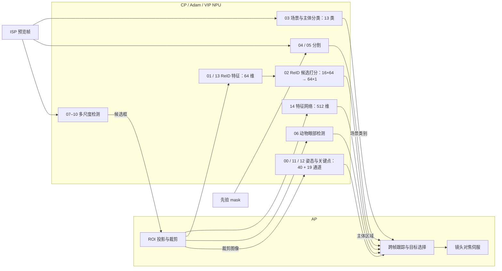

# A6700 主体识别 AF 模型架构

主体识别 AF 由 AP 与协处理器上的 Adam/VIP NPU 协同完成。模型包包含 15 个 NBG 网络，按全帧检测、姿态关键点、动物眼部检测、ReID、分割和场景分类分工。AP 将检测结果转换为 ROI，协处理器运行对应网络，AP 汇总结果并维护跨帧目标状态。

## AP 与协处理器

AP 运行 AArch64 Linux，处理预览帧分发、ROI 投影、跨帧跟踪和镜头伺服。CP 侧的 Adam 加载 NA/NBG 模型包，通过 VIPLite 把网络任务提交给 VeriSilicon NPU。

```text
AP（AArch64 Linux）
├── 预览帧分发与 ROI 投影
├── 目标关联与跨帧跟踪
└── 镜头对焦伺服
        │ ROI、位置、特征
        ▼
CP / Adam
├── NA/NBG 加载
├── VIPLite 运行时
└── VeriSilicon VIP NPU
```

## 网络清单

模型包包含 15 个 NBG 网络。L 为 layer_count，O 为 operation_count。

### 姿态与关键点

| ID | 网络 | 输入 | 输出 | L/O |
|---:|---|---|---|---:|
| 00 | `sony_net_opt_NHWC` | `512×336×3` | `64×42×40` + `64×42×19` | 152/421 |
| 11 | `model.ckpt-1590000_416x288_NHWC` | `416×288×3` | `52×36×40` + `52×36×19` | 139/271 |
| 12 | `model.ckpt-1590000_416x288_r_NHWC` | `288×416×3` | `36×52×40` + `36×52×19` | 139/260 |

三个网络都输出 40 通道辅助特征和 19 通道关键点结果，分别处理主尺寸、横向和竖向输入。

### 目标检测

| ID | 网络 | 输入 | 输出头 | L/O |
|---:|---|---|---|---:|
| 07 | `dummy_network_name` | `320×320×3` | 多尺度 `6/24/30` | 87/162 |
| 08 | `dummy_network_name` | `320×320×3` | 多尺度 `6/24/42` | 90/159 |
| 09 | `dummy_network_name` | `320×320×3` | 多尺度 `6/24/18` | 97/184 |
| 10 | `dummy_network_name` | `320×320×3` | 多尺度 `6/24/42` | 83/134 |

四个检测网络使用不同的多尺度输出头。动物与眼部检测由网络 06 处理：`aed_03_00_05_rc2_NHWC`，输入 `128×128×3`，输出为 `3`、`32×32×3`、`3`、`3`，共 46 层、91 个算子。

### ReID 与特征

| ID | 网络 | 输入 | 输出 | L/O |
|---:|---|---|---|---:|
| 01 | `reid_NHWC` | `64×128×3` | `64` 维特征 | 15/28 |
| 02 | `reidpost_NHWC` | `16×64` | `64×1` | 272/274 |
| 13 | `tflite_djd5-U-resnet7-32_64-esch_lw_quan_max23_NHWC` | `32×64×3` | `64` 维特征 | 16/27 |
| 14 | `sfr_tf_resnet_454-80-160-320-512-nose_NHWC` | `64×64×3` | `512` 维特征 | 71/89 |

网络 01、13、14 提取不同尺度的主体特征；网络 02 接收 16 个 64 维候选特征，输出候选打分结果。

### 分割与分类

| ID | 网络 | 输入 | 输出 | L/O |
|---:|---|---|---|---:|
| 03 | `tfl107_t58_e70_q58_d53_c0_NHWC` | `224×224×3` | 13 类 | 66/73 |
| 04 | `model_NCHW` | `320×180×3` + `320×180×1` | `320×180×1` mask | 78/138 |
| 05 | `model_NCHW` | `320×180×3` + `320×180×1` | `320×180×1` mask | 77/199 |

网络 03 输出 13 类场景/主体分类结果。网络 04 和 05 接收 RGB 图像与先验 mask，生成同分辨率分割 mask。

## 网络连接



07–10 在预览帧上生成候选框。AP 根据候选框计算 ROI，并将裁剪图像送入姿态、动物眼部和特征网络。01、13 输出 64 维特征，由 02 进行候选打分；14 输出 512 维特征。03 提供 13 类场景/主体分类结果，04、05 输出主体区域 mask。AP 汇总网络输出，更新跨帧目标并控制镜头。

## 张量布局

NBG 输入表按 HWC 记录维度，VIP 输入按连续 NHWC 排布。NPU 输出缓冲按 CHW 写回，线性偏移为：

$$\text{Offset}(c,h,w)=c\cdot(H\cdot W)+h\cdot W+w$$

量化张量使用仿射关系：

$$x_{real}=S\cdot(x_{quant}-Z)$$

其中 $S$ 为 `tf_scale`，$Z$ 为 `tf_zero_point`。
